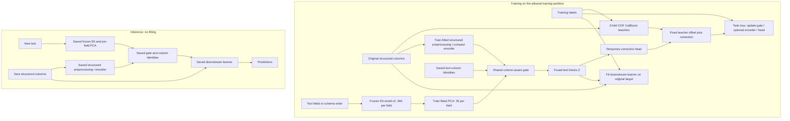

# Option A architecture

Status: the explicit dataset/split contracts and structured-only three-fold
OOF CatBoost teacher are implemented in Phase 2; see [PHASE2.md](PHASE2.md).
Phase 1 reproduced one pinned original Joint Frozen baseline. The frozen
encoder/PCA integration, compact structured encoder, gate, correction head
and final learner are now implemented in Phase 3; milestone verification is
tracked in the handoff. See [PHASE3.md](PHASE3.md) for exact APIs, initial
settings, persistence and the nested diagnostic design. No ReFuTab improvement
is claimed. See [PROJECT_PLAN.md](PROJECT_PLAN.md) for phase gates and
[DATA_LEAKAGE.md](DATA_LEAKAGE.md) for the evaluation protocol.

## Question and comparison

Can residual-guided, context-aware fusion make text representations more useful alongside structured features than standard target-aware text representations? The hypothesis is that correcting a structured-only teacher encourages complementary information; this is untested.

The primary comparator is **Joint TAR**, because ReFuTab uses labels to train its fusion representation even though E5 remains frozen. The minimum comparison is Joint Frozen, Joint TAR, a gate trained directly on the target, and residual-guided fusion. Baseline names and exact implementations must be verified against the historical `master` snapshot before coding. The historical source selection and any uncertainty belong in [DECISIONS.md](DECISIONS.md).

## Data contract and feature order

The implemented dataset schema declares the task, target, ordered text columns,
numerical columns, categorical columns, optional ID, and explicit excluded or
forbidden metadata. Every column needs a declared role; original image-column
datasets are rejected. Targets, row identifiers, split markers, and
target-derived fields cannot enter features. Schema declarations require a
content/provenance audit; the contract cannot detect an undisclosed
target-derived feature. Stable row IDs and complete outer/validation/excluded
assignments are persisted. Group/time constraints require audited explicit
assignments and a compatible OOF schedule; the generic generators do not infer
or enforce them. Classification uses one saved training-derived class order.

**Training interpretation resolved by the user on October 19, 2026:** train separately on each dataset's training split and leave its test split untouched. Keep fitted artifacts and target-trained weights separate for each dataset and outer evaluation fold. Fit preprocessing and models only on the permitted training partition; use an independent inner validation partition for selection. The full OOF teacher construction, final-refit boundaries, and supervised-representation diagnostics remain required by [DATA_LEAKAGE.md](DATA_LEAKAGE.md). This is the user's confirmed project interpretation, not a claim of separate course-staff confirmation.

For row `i` and text field `j`, let `x_ij` be text, `u_i` the original structured
features, and `c_j` a fixed column identity. Schema order is preserved through
encoding, concatenation, serialization and prediction. Missing text becomes
empty before prefixing. The fusion vocabulary reserves missing/unknown codes;
the separate teacher uses stateless typed tokens and native CatBoost hashing.

## Components

1. **Structured teacher (implemented).** CatBoost 1.2.8 receives only declared
   `u` columns. Three OOF teachers fit their respective two-fold complements;
   a fourth model fitted only on inner training provides validation offsets.
   Numerical conversion and typed categorical tokenization are stateless.
   CatBoost learns numerical borders, category statistics, and trees inside
   each model's fitting partition; NaN uses native `nan_mode="Min"`, and unseen
   category tokens use native hashing. Initial settings are 40 CPU iterations,
   depth 4, learning rate 0.1, and seed 42. No calibration, early stopping,
   `eval_set`, or search is fitted. Class order, excluded-row audits, models,
   and aligned scores are saved and validated. See [PHASE2.md](PHASE2.md) for
   the API, exact offsets, and current verification scope.
2. **Frozen text encoder.** E5-small-v2 produces 384-dimensional embeddings. Freeze every encoder parameter, disable training-time dropout, and use inference/evaluation mode. Verify text prefixes, pooling, normalization, and batching against the pinned benchmark during Phase 1; save the chosen settings and exact model revision. No E5 fine-tuning occurs in Option A.
3. **Per-field PCA.** Fit one PCA from 384 to 30 dimensions for each text column using the allowed training partition only. Apply that same fitted transformation to validation and test text in that field. Do not fit separate validation/test PCAs or mix column coordinate systems. If a fitting partition cannot support the required dimensionality, fail with a documented reason; do not silently change the method.
4. **Compact structured representation.** Train-median numerical imputation (all-missing fallback zero) and population standardization use fitting rows only. Typed category vocabularies reserve missing=0 and unseen=1. Each category has an 8-dimensional learned embedding; numeric values and embeddings feed a 16-wide linear/ReLU context projection. These are fixed starting settings, not optima. This fusion input remains separate from the original structured columns supplied to the final learner.
5. **Shared, column-aware gate.** For each field, concatenate `e_ij`, `s_i`, and a fixed identity encoding `c_j` in a small MLP. Start with one hidden layer of width 64, ReLU activation, and dropout 0.1. The output has 30 coordinates. Apply the same gate parameters to every text field:

   ```text
   e_ij = PCA_j(E5(x_ij))
   z_ij = e_ij * (1 + tanh(G_theta(e_ij, s_i, c_j)))
   Z_i  = concat(z_i1, ..., z_im)  # fixed text-column order
   ```

   Initialize the gate's final linear weights and bias to zero, giving `z = e` initially. Hidden width and dropout are starting hyperparameters, not established optimal choices. The multiplicative gate scales each coordinate by a factor between zero and two; it does not create arbitrary new coordinates. Save this restriction as a limitation when interpreting results.
6. **Temporary correction head.** A compact head `H_phi(Z_i)` predicts an adjustment to the fixed teacher score. Train only the gate, structured encoder where applicable, and correction head. Stop gradients through teacher offsets and E5. Use validation to select checkpoints and training settings without inspecting held-out test performance.

## Task-specific training objectives

Let `t_i` be the OOF teacher output for a training row and `h_i = H_phi(Z_i)`.

| Task | Fixed teacher offset | Combined prediction and loss |
| --- | --- | --- |
| Regression | Prediction in the original target scale | `y_hat = t_i + h_i`; start with mean squared error and record any alternative |
| Binary classification | `t_i = log(p_i / (1 - p_i))`, after clipping `p_i` to `[epsilon, 1 - epsilon]` | `logit = t_i + h_i`; binary cross-entropy with logits |
| Multiclass classification | A vector of clipped, renormalized class log-probabilities in the saved class order | `scores = t_i + h_i`; multiclass cross-entropy |

The implemented teacher records `epsilon=1e-7` initially and clips to
`[epsilon, 1-epsilon]`; multiclass probabilities are then row-renormalized
before taking logs. Binary class index 1 is positive in the saved class order.
No probability calibration is fitted. Any future calibration must stay inside
the teacher's allowed training data; calibration on the row being predicted
would break OOF exclusion. These offsets and all three combined correction
losses in the table are implemented.

The **standard gated fusion ablation** keeps E5, PCA, structured representation, gate, head capacity, splits, and comparable training budget aligned, but predicts the original target through the head without a teacher offset. Retrain its own final downstream learner. This isolates the residual objective from the benefit of supervised gating. Evaluate the final downstream predictions, not just the temporary head's loss.

## Downstream training and inference

After representation training, discard the temporary correction head. The teacher is not part of the final prediction path. Construct:

```text
final_features_i = [original_structured_features_i, Z_i]
prediction_i = downstream_tabular_learner(final_features_i)
```

Train the downstream MulTaBench learner on the original task target. Preserve its benchmark preprocessing/interface where possible; the structured representation `s` is an internal gate input, not a replacement for the original structured feature block. Freeze the learned fusion representation while fitting this downstream learner unless a later, explicitly documented design change is approved.



The diagram shows component roles; validation, final refitting, and fold boundaries are defined in [DATA_LEAKAGE.md](DATA_LEAKAGE.md). There is no correction-head or teacher call at final inference.

## Artifacts and evaluation boundaries

A reproducible prediction bundle must include the schema and class mapping; E5 identifier/revision and encoding settings; per-column PCA state; structured preprocessing and optional encoder state; gate state/configuration; downstream model and its preprocessing; and compatible dependency versions. Training records also retain split IDs, seeds, teacher provenance, checkpoint selection, and source commit. Large artifacts belong in an appropriate artifact store, not Git.

The official performance requirements are AUROC for classification and R-squared for regression (PDF Section 2.3, page 3). The user confirmed coverage is limited to benchmark datasets whose original schema has no image column and permitted separate training on each dataset's training split with untouched test data. Phase 1 verified the 20-dataset eligible roster and historical multiclass AUROC behavior; each additional CSV still needs pinning and a feature audit. See [COURSE_REQUIREMENTS.md](COURSE_REQUIREMENTS.md). Independently fitted supervised fusion spaces also require the diagnostic in [DATA_LEAKAGE.md](DATA_LEAKAGE.md) before final claims. Option B/LoRA remains out of scope until Option A is evaluated and a later phase authorizes it.
